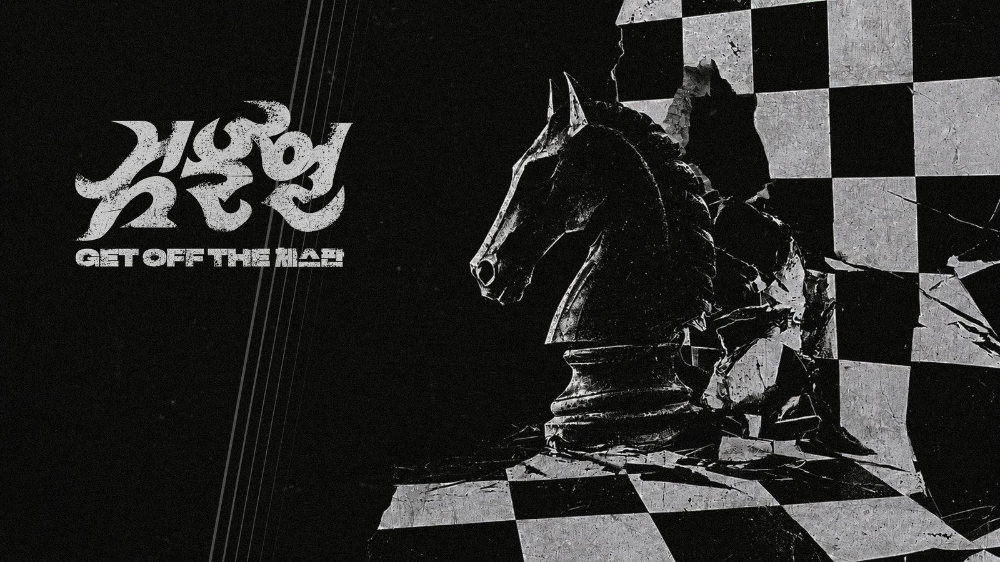
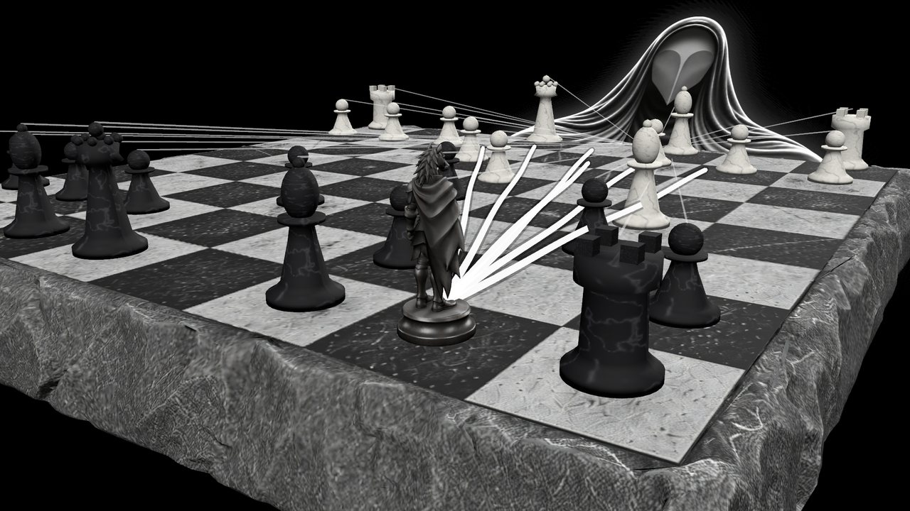
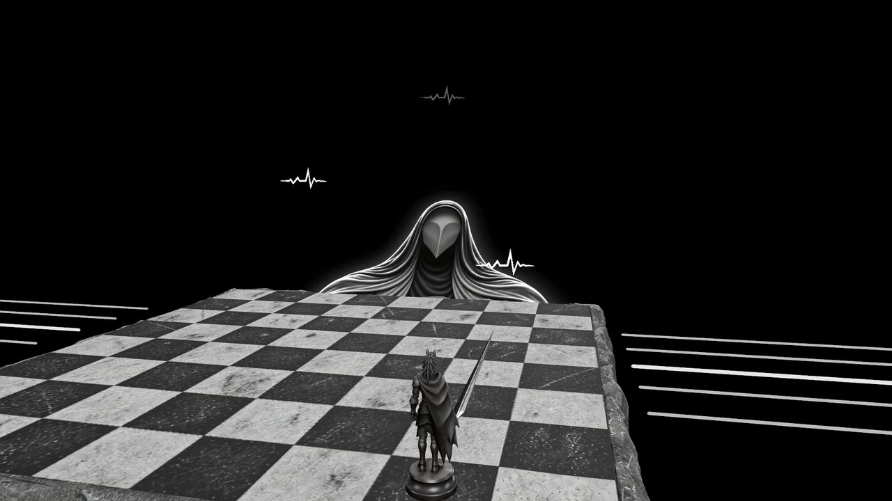
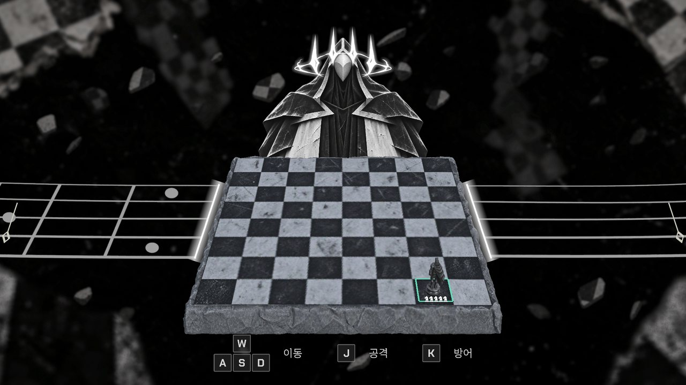

<div align="center">



# 검을 현 · String As a Sword

**판에 박히지 않는 단 하나의 말, 나이트가 되어 체스판의 왕을 베는 리듬 액션 게임**

이승윤 「검을 현」의 박자에 맞춰 움직이고, 판에 박힌 현을 뜯어 검으로 쥔다.

Unity 6 · URP · Windows · 1인용 · 한국어

[이 게임은](#이-게임은) · [플레이 방법](#플레이-방법) · [실행하기](#실행하기) · [프로젝트 구조](#프로젝트-구조) · [크레딧과 라이선스](#크레딧과-라이선스)

</div>

> [!NOTE]
> 원곡 권리자와 관계없는 비공식·비상업 팬 메이드 프로젝트입니다. **원곡 음원은 이 저장소에 들어 있지 않습니다.**

## 이 게임은

체스판의 말들은 규칙에 박혀 있습니다. 왕이 칸을 비추면 그 칸으로, 한 박에 한 수씩만 움직입니다. 말을 뛰어넘는 나이트만은 판에 박히지 않습니다. 원곡의 가사와 구조를 게임의 규칙으로 옮겼습니다.

| 게임 속 | 의미 |
| --- | --- |
| 체스판 | 규칙이 말을 박아 둔 판. 한 박에 한 번만 움직일 수 있다 |
| 나이트 | 플레이어. 판에 박히지 않는 말, 규칙에 저항하는 말 |
| 현 | 시스템이 판에 박아 둔 줄. 나이트는 이것을 뜯어 검으로 쥔다 |
| 잡음 | 주선율이 쓰다 버린 선율. 모아서 왕의 주선율을 빼앗는다 |
| 왕 | 보스. 주선율이자 체스판의 시스템, 나이트를 묶으려 한다 |
| 판 밖 | 규칙과 시스템이 없는 세계. 나이트가 나가려는 곳 |

<table>
  <tr>
    <td width="50%"></td>
    <td width="50%"></td>
  </tr>
  <tr>
    <td>프롤로그 · 엇박에 뛴 나이트를 왕의 현이 다리째 판에 묶는다</td>
    <td>프롤로그 · 현을 뜯어 쥔 검으로 왕과 마주 선다</td>
  </tr>
  <tr>
    <td colspan="2"></td>
  </tr>
  <tr>
    <td colspan="2">전투 · 판 양옆의 레인으로 노트가 흐르고, 나이트는 박마다 한 칸씩 움직인다</td>
  </tr>
</table>

## 플레이 방법

메인화면 → 프롤로그 → 튜토리얼 → 전투 → 엔딩 순서로 진행합니다. 프롤로그와 튜토리얼은 시작할 때마다 나오며, <kbd>Esc</kbd>로 건너뛸 수 있습니다.

1. **박에 맞춰 움직입니다.** 8×8 판 위에서 한 박에 한 칸씩 움직일 수 있습니다(87 BPM).
2. **왕의 공격을 막거나 피합니다.** 공격할 칸이 먼저 예고됩니다. <kbd>K</kbd>로 막거나 다른 칸으로 피하세요. 빗금 공격은 막을 수 없어 피해야 합니다.
3. **잡음을 주워 현을 충전합니다.** 판에 떨어진 잡음이 왕을 벨 힘이 됩니다.
4. **맨 윗줄에서 <kbd>J</kbd>로 공명을 일으킵니다.** 충전된 채로 맨 윗줄에서 공격하면 8노트 동안 공명이 이어지고, 그동안 노트에 맞춰 <kbd>J</kbd>를 누를 때마다 왕이 피해를 입습니다. 공명이 없으면 공격은 통하지 않습니다.
5. **곡 끝의 3연타가 시작될 때 왕이 무력화되어 있으면 이깁니다.** 그때까지 HP를 다 깎지 못하면 집니다.

| 키 | 동작 |
| --- | --- |
| <kbd>W</kbd> <kbd>A</kbd> <kbd>S</kbd> <kbd>D</kbd> | 한 칸 이동 |
| <kbd>J</kbd> | 공격 (맨 윗줄에서) |
| <kbd>K</kbd> | 막기 |
| <kbd>Esc</kbd> | 일시정지 |
| <kbd>Enter</kbd> / <kbd>Space</kbd> | 메뉴 선택 |

설정에서 난이도(쉬움·어려움), 음량, 입력·음악 오프셋을 바꾸고 튜토리얼을 다시 볼 수 있습니다. 쉬움에서는 잡음을 주울 때 HP가 1 회복됩니다.

## 현재 상태

- [x] 프롤로그: 엔진 안에서 그리는 컷씬, <kbd>J</kbd>로 현을 뜯으면 튜토리얼로 이어짐
- [x] 튜토리얼: 이동, 막기·회피, 잡음 줍기, 공명 공격
- [x] 보스전 한 곡, 난이도 쉬움·어려움
- [x] 엔딩: 판이 무너지고 하얀 세계로
- [ ] 프롤로그 소리 에셋: 작곡 큐, 체스 클록 녹음, 현 녹음 2종 (지금은 자리표시 소리)

## 실행하기

내려받아 바로 할 수 있는 빌드는 공개하지 않습니다. 빌드에는 원곡 음원이 들어가기 때문입니다. 소스에서 직접 실행해 주세요.

**필요한 것:** Windows, Unity **6000.5.5f1**(URP), [Git LFS](https://git-lfs.com)

그림·모델·소리는 Git LFS로 받으므로 clone 전에 LFS를 켜 두세요.

```powershell
git lfs install
git clone https://github.com/Choi0427/String-As-a-Sword.git
```

1. Unity Hub에서 clone한 폴더를 열고 Unity 6000.5.5f1을 고릅니다.
2. `Assets/_Project/Scenes/MainMenu.unity`를 열고 Play를 누릅니다.

> [!IMPORTANT]
> 원곡 음원은 저작권 때문에 넣지 않았습니다(`.gitignore`). 음원이 없으면 전투가 음악 없이 진행됩니다. 직접 가진 음원으로 플레이하려면 파일을 `Assets/_Project/`에 넣고 `Assets/_Project/Data/Songs/GeomEulHyeon87`의 Music 칸에 연결하세요.

Windows 빌드 방법과 검증 기록은 [Docs/WindowsBuild.md](Docs/WindowsBuild.md)에 있습니다. 테스트는 Unity의 Test Runner(EditMode·PlayMode)에서 돌립니다.

## 프로젝트 구조

| 경로 (`Assets/_Project/` 아래) | 내용 |
| --- | --- |
| `Scripts/Core` | 게임 흐름과 씬 전환 (`GameFlow`, `PrototypeGame`) |
| `Scripts/Combat` | 전투 규칙: 공격 판정, 보스 패턴, 보스 채보 (`BattleSession`) |
| `Scripts/Rhythm` | 곡 시계, 박 타임라인, 입력 판정 (`SongClock`, `RhythmJudge`) |
| `Scripts/Stage` · `Board` · `Player` | 잡음 줍기와 페이즈 전환, 판 상태, 키 입력 |
| `Scripts/Presentation` | 화면 연출: 프롤로그, 튜토리얼, 엔딩, HUD |
| `Scripts/Simulation` | 밸런스 측정용 봇 |
| `Editor` | `String As a Sword` 메뉴: 에셋 설정, 채보 가져오기 |
| `Data/Songs` | 곡 정의와 채보 |
| `Art` · `Audio` | 그림, 3D 모델, 글꼴, 효과음 |
| `Scenes` | `MainMenu`, `RhythmPrototype` |
| `Tests` | EditMode, PlayMode 테스트 |

규칙(`Combat`, `Rhythm`, `Stage`)은 화면과 분리되어 있습니다. 그래서 같은 규칙을 봇으로 수백 판씩 돌려 난이도별 클리어율을 재고 밸런스를 맞췄습니다(예: [Battle11Balance.md](Docs/Battle11Balance.md)).

| 문서 | 내용 |
| --- | --- |
| [GameFlow.md](Docs/GameFlow.md) | 메인화면부터 엔딩까지 전체 흐름. 여기서 시작하세요 |
| [BossCombat.md](Docs/BossCombat.md) | 보스 전투 규칙 |
| [LyricBossDesign.md](Docs/LyricBossDesign.md) | 곡 구간에 맞춘 보스 패턴 설계 |
| [ChartBalance.md](Docs/ChartBalance.md) | 채보와 밸런스 측정 |
| [ArtPipeline.md](Docs/ArtPipeline.md) | 아트 에셋을 넣는 방법 |
| [IntroAssets.md](Docs/IntroAssets.md) | 프롤로그의 소리와 에셋 |

## 크레딧과 라이선스

| 구성 요소 | 권리 | 비고 |
| --- | --- | --- |
| 원곡 이승윤 「검을 현」 (정규 3집 『역성』, 2024) | 곡·가사·음원 모두 각 권리자 | 음원은 저장소에 없음. 게임 이름과 엔딩의 「易聲」 글씨는 이 곡과 앨범에 대한 오마주 |
| 3D 모델: 체스판, 검 | [Meshy](https://www.meshy.ai)로 생성 | |
| 글꼴: [Orbit](https://github.com/JAMO-TYPEFACE/Orbit), [Chakra Petch](https://github.com/m4rc1e/Chakra-Petch), 학교안심 곧은제목(KERIS), Liberation Sans | SIL Open Font License 1.1 | Liberation Sans는 TextMesh Pro 기본 글꼴 |
| 코드와 설계 문서 | 팀 | 라이선스 미정 |

라이선스를 정하기 전까지 LICENSE 파일이 없으므로, 이 저장소의 코드와 에셋을 재사용하거나 재배포할 권리는 주어지지 않습니다.
